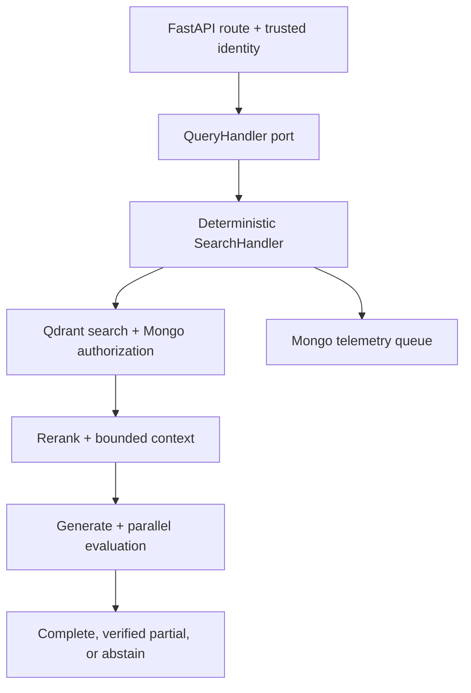

# Adaptive Deterministic RAG

An asynchronous FastAPI backend for bounded, multi-tenant retrieval-augmented generation. MongoDB
is the authoritative database and telemetry store; Qdrant is the read-only runtime retrieval index;
OpenAI is the default text and embedding provider; Cohere is the configured reranker.

The service deliberately keeps model intelligence inside deterministic boundaries. Models return
schema-validated suggestions and evaluations. Python code owns retries, security filters, budgets,
and terminal states.

## Current scope

- `POST /v1/rag/query` for conversational or standalone RAG queries.
- Dense and BM25 sparse Qdrant search, rank fusion, MongoDB authorization hydration, Cohere
  reranking, structural context completion, bounded context packing, grounded generation, and
  parallel faithfulness/completeness evaluation.
- Follow-up detection that rewrites only ambiguous conversational turns, and numbered citations
  that point only at verified sources.
- Four finite search tries: happy path, recall expansion, query recovery, and context isolation.
- One generation repair at most, then `COMPLETE`, `VERIFIED_PARTIAL`, or
  `INSUFFICIENT_EVIDENCE`.
- Request events and detailed RAG traces stored centrally in MongoDB.
- No production ingestion, document-mutation, or vector-write API.

Langfuse, agent modes, deep-research flows, recency scoring/decay, and multiple reranker providers
are intentionally **not implemented**. The ports and composition root leave room for them without
putting speculative code in the current runtime.

## Repository layout

| Path | Responsibility |
| --- | --- |
| `config/` | Committed stable defaults and the safe local overlay |
| `src/app.py` | FastAPI factory and lifespan |
| `src/server.py` | ASGI entrypoint and local runner |
| `src/container.py` | Startup-only provider resolution and dependency composition |
| `src/routes/` | HTTP transport, controllers, validators, and dependencies |
| `src/middleware/` | Concurrency-safe ASGI request context and request telemetry |
| `src/handlers/` | RAG orchestration and deterministic policy |
| `src/handlers/search_strategies/` | One module per bounded search try |
| `src/models/` | Domain models, request/response shapes, model output schemas, and trace records; imports no other application package |
| `src/services/` | Reusable application services and provider-facing protocols |
| `src/providers/` | OpenAI, Cohere, MongoDB, and Qdrant client adapters, and the BM25 sparse encoder |
| `src/managers/` | All normal runtime MongoDB and Qdrant operations |
| `src/db/` | Collection declarations, physical vector index naming, and idempotent startup initialization |
| `src/utils/` | Settings, prompts, logging, errors, and task-local request context |
| `scripts/seed_dummy_data.py` | The only dummy-data/vector writer; local development only |
| `scripts/smoke_live_providers.py` | One live call per provider operation; checks keys, models, and schemas |
| `tests/` | Unit, boundary, concurrency, and in-memory Qdrant tests |
| `eval/` | Example offline evaluation fixtures: a golden question set and ranking-metric inputs |
| `docs/` | Architecture and dependency rules, and the adversarial review record |

Python modules use snake_case even where the conceptual folder name is “search strategies.”

## Request flow



Qdrant receives mandatory tenant, role, and active-version filters inside the vector manager.
MongoDB then rehydrates candidate content and independently rechecks tenant, ACL, deletion state,
and the authoritative current document version before content enters a prompt.

## Configuration model

Stable and safe values live in YAML. Secrets, external endpoints, and deployment selection come
from environment variables with no application prefix.

| Source | Examples |
| --- | --- |
| `config/default.yaml` | Models, candidate budgets, follow-up detection, policy bounds, timeouts, collection alias, sparse encoder |
| `config/local.yaml` | Local-only overrides: `DEBUG` logging and smaller telemetry queue and batch sizes |
| Environment / `.env` | API keys, MongoDB URI, Qdrant URL/key, trusted-header secrets |
| Environment / `.env` | `APP_ENV`, `CONFIG_DIR`, and `TELEMETRY_HASH_KEY` |

`APP_ENV=local` loads `default.yaml` and then `local.yaml`. Other environments load only
`default.yaml`; no `dev.yaml` or `prod.yaml` is required. Unknown YAML keys fail startup so a typo
cannot silently select a default.

`APP_ENV` defaults to `production` when unset, so a missing value fails closed. Production startup
rejects the placeholder `AUTH_SHARED_TOKEN`, `DEBUG_TOKEN`, and `TELEMETRY_HASH_KEY` values, and it
rejects any of the three that is shorter than 32 characters or equal to another of the three.
Production also requires `https://` for each endpoint that receives a credential: `OPENAI_BASE_URL`
when `OPENAI_API_KEY` is set, `COHERE_BASE_URL` when `COHERE_API_KEY` is set, and `QDRANT_URL` when
`QDRANT_API_KEY` is set. A `MONGODB_URI` that carries a username or password must use
`mongodb+srv://` or request TLS with `tls=true` (or `ssl=true`).

The complete environment surface is:

```dotenv
# Unset APP_ENV means production.
APP_ENV=local
CONFIG_DIR=config
OPENAI_API_KEY=
OPENAI_BASE_URL=
COHERE_API_KEY=
COHERE_BASE_URL=https://api.cohere.com
MONGODB_URI=mongodb://localhost:27017
QDRANT_URL=http://localhost:6333
QDRANT_API_KEY=
AUTH_SHARED_TOKEN=replace-this-auth-token
DEBUG_TOKEN=replace-this-debug-token
TELEMETRY_HASH_KEY=replace-this-telemetry-key
```

Model calls use OpenAI Structured Outputs in strict mode. The provider sends each output model's
schema with its defaults removed, because strict mode rejects `default`; the defaults still apply
when the application builds those models itself. `ai.reasoning_effort` maps a model name to the
reasoning effort sent with its calls (default: `gpt-5.6-luna: low`). Models not listed use the
provider default. Reasoning tokens count against `ai.max_output_tokens`.

There is no model-price table. Traces record provider-reported token usage and provider request IDs
from API responses. They do not invent a dollar cost when a provider response does not contain one.

## Local development

Requirements: `uv`, Docker Compose, and Python 3.13.9. Run these steps in order.

1. Install dependencies and create `.env`:

   ```bash
   uv python install 3.13.9
   uv sync --frozen --all-groups
   cp .env.example .env
   ```

   Add valid OpenAI and Cohere keys and replace the placeholder `AUTH_SHARED_TOKEN`, `DEBUG_TOKEN`,
   and `TELEMETRY_HASH_KEY` values. `.env.example` sets `APP_ENV=local`, which the seed script
   requires.

2. Confirm that your keys can reach every configured model. The script makes one live call per
   operation (embedding, rerank, follow-up detection, contextualization, query recovery, generation,
   and both evaluators), prints one line each, and exits non-zero if any fails. It needs no
   database.

   ```bash
   PYTHONPATH=src uv run --frozen python scripts/smoke_live_providers.py
   ```

3. Start the backing stores:

   ```bash
   docker compose up -d mongo qdrant
   ```

4. Seed the local handbook (see [Local dummy seed](#local-dummy-seed)). Until this runs, the index
   is empty and every query ends in `INSUFFICIENT_EVIDENCE`.

   ```bash
   PYTHONPATH=src uv run --frozen python scripts/seed_dummy_data.py \
     --tenant-id local-tenant --user-id local-admin
   ```

5. Start the API on the host:

   ```bash
   uv run --frozen uvicorn server:app --app-dir src --host 0.0.0.0 --port 8000
   ```

   Or run the API in Docker as well. The compose file sets `APP_ENV=local` and points the API at the
   `mongo` and `qdrant` services; the seed from step 4 is already in their volumes.

   ```bash
   docker compose up --build
   ```

6. Send the [example query](#routes). The seed grants the `reader` and `administrator` roles in
   `local-tenant`, which matches the example headers. OpenAPI is available at
   `http://localhost:8000/docs`.

If the first run fails:

| Symptom | Cause and fix |
| --- | --- |
| A smoke-test line shows `FAIL` | The key cannot use that model, or the model rejects the configured reasoning effort. Change the model, or remove it from `ai.reasoning_effort`. |
| Startup reports that `adaptive_rag_chunks` uses the legacy layout | A collection from an older version has the alias name. Delete it (or the `qdrant-data` volume) and seed again. |
| Startup reports that the alias points to another collection | The embedding model, dimension, sparse settings, or vector names changed. The seed script runs the same check, so delete the alias first (locally, deleting the `qdrant-data` volume also works), then seed again; it creates the new physical collection and points the alias at it. See [Retrieval index](#retrieval-index). |
| Every answer is `INSUFFICIENT_EVIDENCE` | The index is empty, or the request's tenant or roles do not match the seeded document. |

## Routes

| Method and path | Authentication | Purpose |
| --- | --- | --- |
| `GET /health/live` | None | Process liveness |
| `GET /health/ready` | None | MongoDB and Qdrant readiness |
| `POST /v1/rag/query` | Trusted identity | Run bounded RAG |
| `GET /v1/rag/requests/{request_id}/trace` | Trusted identity + debug token | Read a trace as its owner or a tenant administrator |

The trusted-header adapter expects:

| Header | Meaning |
| --- | --- |
| `X-Auth-Token` | Gateway-to-service shared secret |
| `X-Tenant-ID` | Tenant authorization boundary |
| `X-User-ID` | Audited caller and conversation owner |
| `X-Roles` | Comma-separated document roles |
| `X-Debug-Token` | Additional secret for trace access |

A trusted reverse proxy must authenticate the caller, strip client-supplied identity headers, and
inject these values. Replace this adapter with verified OIDC/JWT authentication before exposing the
service directly to untrusted clients.

Example query:

```bash
curl -sS http://localhost:8000/v1/rag/query \
  -H 'X-Auth-Token: replace-this-auth-token' \
  -H 'X-Tenant-ID: local-tenant' \
  -H 'X-User-ID: local-user' \
  -H 'X-Roles: reader' \
  -H 'Content-Type: application/json' \
  -d '{"conversation_id":"demo","message":"How does deterministic search stop?"}'
```

## Local dummy seed

Production source contains no vector write operation. The sole writer is the fixed, idempotent
local seed script, and it refuses to run unless `APP_ENV=local`. There is no HTTP seed route. Run it
directly, as in step 4 of [Local development](#local-development).

It creates the physical collection and alias when they are missing, writes dense embeddings and
BM25 sparse vectors, and links chunks in sequence. It uses the same encoder settings as the API, so
both resolve to the same physical collection.

## Retrieval index

Queries address `vector_store.collection_alias` (default `adaptive_rag_chunks`), not a physical
collection. The alias targets `<alias>__<digest>`, where the digest hashes the encoder fingerprint,
cosine distance, IDF modifier, vector names, and dense dimension. Changing the embedding model,
dimension, sparse settings, or vector names therefore creates a new physical collection instead of
mixing incompatible vectors.

Sparse vectors are BM25 term weights hashed into `vector_store.sparse.hash_space`. Qdrant applies IDF
at query time, so the sparse vector configuration must request the IDF modifier.

Startup validates the physical collection (dense size and distance, sparse vector name, IDF
modifier) and attaches the alias only after validation. It fails when the alias targets another
collection, or when a legacy collection uses the alias name. Both errors name the migration: reindex
into the new physical collection, then switch the alias.

## Answers and conversational queries

History is read only when a request has a `conversation_id` and `contextualization.enabled` is true.
A follow-up detector (`contextualization.detector`: `model`, `heuristic`, or `always`) estimates
whether the message depends on earlier turns. Below `followup_threshold` the literal question is
used unchanged. Otherwise the rewrite sees only relevant turns (score at or above
`message_threshold`, plus the last `min_recent_messages`), trimmed to `max_context_characters`.
A detector timeout or infrastructure failure fails open: the message is treated as a follow-up of
the whole history, still bounded by that limit.

Answers cite evidence with numbered markers such as `[1]` or `[1, 2]`. `citations` lists each cited
passage once, numbered by first appearance. Markers that do not refer to verified evidence are
removed. Setting `answers.inline_citations: false` removes all markers and returns no citations.
Partial answers end with a verification disclosure that lists the unanswered requirements.
`metadata.degraded` is true when a stage timeout or infrastructure failure was salvaged into a
verified partial answer.

## Startup and observability

The FastAPI lifespan owns all shared asynchronous clients. Startup concurrently initializes the
two independent stores, creates missing MongoDB collections, ensures all MongoDB indexes and TTLs,
creates the physical Qdrant collection, its payload indexes, and the alias when absent, and rejects
an incompatible existing vector schema.

One bounded telemetry service captures HTTP events, RAG attempt events, errors, provider usage, and
detailed request traces. Its sink is a small protocol; MongoDB is the only implementation today.
Writes are batched off the response path, queued traces remain readable in-process, and shutdown
drains the queue within `telemetry.shutdown_timeout_seconds` before the external clients close.

Trace text follows `telemetry.content_mode`. `redacted` (the default) stores lengths and
HMAC-SHA256 digests keyed by `TELEMETRY_HASH_KEY`, `metadata_only` stores lengths only, and `full`
stores text. Application logs are structured JSON on stderr. Queue saturation and sink failures are
logged there with the affected request IDs. OpenTelemetry is not used.

## Extension boundaries

- Routes depend on `QueryHandler`, not `SearchHandler`; another explicitly selected query mode can
  be composed later without rewriting transport code.
- Search tries implement `SearchStrategy` and are registered once in a finite registry.
- Model, embedding, vector search, reranker, repository, conversation, and telemetry dependencies
  are narrow `Protocol` ports.
- `container.py` is the only composition root and the only place that selects concrete providers.
- Ranking and context construction are separate services, leaving a focused seam for future scoring
  policies without adding recency behavior now.

## Quality gates

```bash
uv lock --check
uv run ruff format --check src scripts tests
uv run ruff check src scripts tests
uv run mypy
uv run pytest --cov --cov-report=term-missing
uv pip check
```

CI (`.github/workflows/ci.yml`) runs the first five on every push and pull request, with ruff over
the whole repository. Run `uv pip check` locally; CI does not.

See [docs/architecture.md](docs/architecture.md) for dependency rules and
[docs/adversarial-review.md](docs/adversarial-review.md) for the completed review loop.
