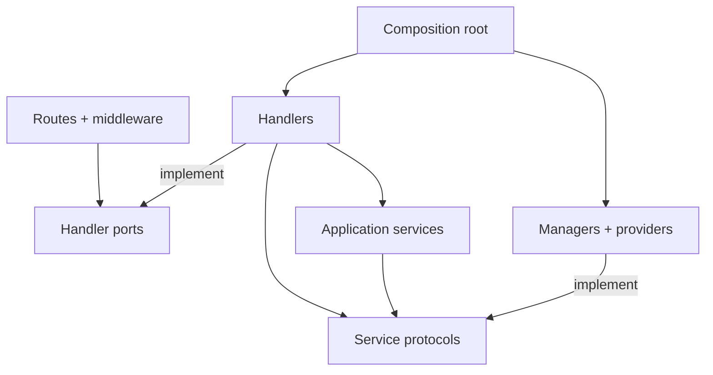

# Implementation architecture

This document describes the implemented RAG backend. It adapts the supplied *Adaptive Deterministic
RAG Platform — Architecture and Design Specification* to the current read/query-only scope. The
specification's ingestion and document lifecycle are outside this service; the only writer is the
gated local seed script, which has no HTTP route.

## Dependency rule

- `models/` and the narrow protocols in `services/contracts.py` and `handlers/contracts.py` are the
  inward-facing contracts. `models/` imports no other application package.
- Handler ports are `QueryHandler`, `TraceQueryHandler`, `ReadinessHandler`, and
  `TransportTelemetry`. Routes, middleware, and HTTP error mapping (`routes/exceptions.py`) reach
  the application only through these ports, via the `RouteContext` protocol in
  `routes/dependencies.py`. They never import `container`, managers, providers, `db`, or `scripts`.
- Routes validate transport data and invoke a handler port. They do not call databases or provider
  SDKs.
- Handlers own use-case orchestration and deterministic transitions. `SearchHandler` answers
  queries, `TenantTraceHandler` scopes trace reads, and `DependencyReadinessHandler` runs readiness
  checks.
- Services own focused query understanding, encoding, retrieval, context, generation, evaluation,
  citation, and telemetry behavior. They depend only on models, service protocols, other services,
  and utils; strategy breadth reaches them as a `RetrievalPlan` model, not a handler type.
- Managers own all normal runtime MongoDB and Qdrant operations and do not import providers.
- Providers construct or adapt external clients and translate provider responses.
- `container.py` resolves the configured implementations once at startup. Business modules contain
  no provider-selection conditionals.
- `db/initializer.py` is the deliberate exception to manager-only runtime access: it owns
  idempotent collection, index, and alias initialization during startup, not request-time business
  queries.
- `scripts/seed_dummy_data.py` is a second, gated local-development exception: it refuses to run
  outside `APP_ENV=local` and composes its own clients. No file under `src/` writes Qdrant points or
  imports `scripts`; `tests/test_seed_boundary.py` enforces both with an AST scan.
- `scripts/smoke_live_providers.py` composes the OpenAI and Cohere adapters directly to make one
  live call per operation. It reads and writes no stored data.

## Async lifecycle and concurrent requests

The FastAPI lifespan awaits `create_container` after settings validation. It validates every
configured implementation name before constructing any client, tracks each client as it is
created, and closes all of them if composition fails. The container owns and closes the
asynchronous OpenAI, Cohere HTTP, MongoDB, and Qdrant clients. Shutdown closes telemetry first,
then every client concurrently; each close is bounded by a timeout and failures are logged.

Shared objects are either SDK clients intended for concurrent use or synchronization-safe services:

- per-request RAG state is allocated inside `SearchHandler.query`;
- request ID and identity use `ContextVar` and are mirrored on `request.state`, so middleware holds
  no mutable request state and error mapping can still read them after the middleware resets;
- dense and sparse retrieval are one batched Qdrant `query_batch_points` call;
- faithfulness and completeness evaluation, and the MongoDB and Qdrant startup branches, run with
  `run_pair` (an `asyncio.TaskGroup`; a failure cancels the sibling and re-raises the original
  error);
- recovered query variants run with `run_all` under a semaphore created per call;
- the query-embedding cache is single-flight: concurrent misses for the same text share one call;
- telemetry uses a bounded queue and one background batch writer;
- shutdown stops acceptance, drains queued telemetry within a bounded time, then closes providers.

Every external stage has a timeout: follow-up detection, contextualization, query recovery,
embedding, retrieval, reranking, generation, and evaluation use the budgets in `timeouts`, and
MongoDB operations use the client-side `mongodb.operation_timeout_ms`. The handler wraps the
complete workflow in a global request deadline. Understanding and strategy attempts run under
`request_seconds - finalization_reserve_seconds`, which leaves time to recheck passages and store the
conversation turn.

When the attempt deadline expires, or a stage raises `TimeoutError` or `InfrastructureError`, the
best verified answer found so far goes through final evidence checks before it can be returned as
`VERIFIED_PARTIAL` with `metadata.degraded = true`.
Without one, the error is raised unchanged. A nested provider timeout remains an operation timeout;
only an expired request or attempt deadline is reported as `REQUEST_DEADLINE_EXCEEDED`.

Each adapter translates its own client's timeout at its boundary, before the broad SDK error
handler: OpenAI's `APITimeoutError`, an HTTPX `TimeoutException` from Cohere, a Qdrant
`ResponseHandlingException` whose `source` is an HTTPX timeout, and a PyMongo error whose
`timeout` is true. It raises `OperationTimeoutError`, a `TimeoutError` that is not an
`InfrastructureError`, so the handler salvages it like a stage timeout and the route answers 504
`OPERATION_TIMEOUT`. Every other provider or store failure stays an `InfrastructureError` (503).
Readiness turns a dependency timeout back into `InfrastructureError`, so `/health/ready` reports
503.

## Startup initialization

Settings validation accepts `context.tokenizer_encoding: o200k_base` only when
`context.tokenizer_verified_for` exactly matches `ai.generation_model`. Before constructing
external clients, the container loads the vocabulary from `.tokenizer/o200k_base.tiktoken`,
verifies its SHA-256 and constructs the ordinary-text counter once. A missing or corrupt asset
fails startup. Byte mode skips the asset and requires a null verification setting.

`DatabaseInitializer.ensure_ready` initializes MongoDB and Qdrant concurrently.

MongoDB startup:

1. pings the server;
2. creates missing application, conversation, telemetry, and trace collections;
3. ensures tenant, identity, current-version, and sequence indexes;
4. ensures trace and event TTL indexes. A longer retention is applied to an existing TTL index in
   place with `collMod`, which needs a role beyond `readWrite` (such as `dbAdmin`) on the
   database. A shorter retention fails startup, because lowering a TTL deletes stored records;
   apply it by hand with `collMod`;
5. fails startup on any other incompatible existing index.

Qdrant startup works on a physical collection named `<collection_alias>__<digest>`. The digest
covers the query encoder fingerprint, the distance, the sparse IDF setting, the vector names, and
the dense dimension, so any encoder or layout change needs a new collection.

1. fails startup when the alias points to a different collection (reindex, then switch the alias),
   or when a plain collection already uses the alias name (legacy layout);
2. creates the physical collection if absent, with a cosine dense vector and a sparse vector that
   uses Qdrant's IDF modifier when the sparse encoder requires it;
3. validates the dense vector size and cosine distance, the named sparse vector, and its IDF
   modifier, and fails startup on any conflict;
4. ensures keyword payload indexes for tenant, role, document, version, and section, and a boolean
   index for `active`;
5. attaches the alias to the physical collection when it was absent, accepting only a concurrent
   create that targets the same collection.

Queries and readiness checks always address the alias.

## Query state machine

| Condition | Deterministic action |
|---|---|
| Request has a conversation ID and contextualization is enabled | Read the scoped tail, authorize complete pairs, and project a character-bounded window before detection |
| Follow-up detected in that window | Propose a standalone question from selected messages. Check explicit anchors and content-word loss before choosing the search and reranking query |
| Initial request | Run `HAPPY_PATH` |
| Verification enabled and a draft has no letter or digit outside its markers, more than 32 markers, or more than 32 labels in one marker | Skip both judges, record the attempt outcome, keep any earlier partial, and classify `UNCLASSIFIED`. A blank repair still spends the repair |
| Evaluators both pass | Select `COMPLETE` for final evidence checks. With verification enabled, every marker must be supported at its position and every answered requirement must cite packed evidence |
| Verification enabled and the completeness judge reports `COMPLETE` with no named requirement or no valid support | Treat it as a provider response error: salvage an earlier verified partial or fail the request |
| Correctable generation failure and repair unused | Repair once, then reevaluate. Correctable means the answer omitted content the evidence holds, correcting evidence exists, or an otherwise complete answer has unsupported or contradicted claims to remove; never when the evidence lacks a requirement or no material claim is supported |
| Any other failure | Classify a retry hypothesis and run its next unused strategy |
| Budget spent and a verified partial answer exists | Select the best partial for final evidence checks |
| No answer with verified support | Return `INSUFFICIENT_EVIDENCE` |
| Attempt deadline or stage failure after a verified partial | Select the best partial for final evidence checks and mark it degraded |
| All current and inherited evidence still matches | Present the selected answer and its current verified sources. Store the same partial disclosure with the plain-text answer |
| A selected or inherited passage disappeared, changed or no longer qualifies | Present and save the standard abstention with empty sources and citations |
| Final evidence read fails or times out | Propagate the operational error |
| Provider or deadline failure with nothing verified | Raise a typed operational error |

Query understanding is optional (`contextualization.enabled`). With conversation history, the
configured `FollowupDetector` (`model`, `heuristic`, or `always`) returns a follow-up probability and
one relevance score per earlier message. If the detector times out or its provider fails, the
request fails open and is treated as a follow-up. Below `followup_threshold` the literal question
is used. Otherwise the rewrite model sees only the messages scored at or above `message_threshold`,
plus the last `min_recent_messages` when they fit. Both stages count the exact chronological
`role: content` strings against `max_context_characters`. A single oversized newest message
contributes a suffix after its role prefix. The current question, JSON syntax and fixed prompt
text are outside the limit. Detector indexes refer to this projected window.
An empty proposal falls back to the literal question. A changed proposal must preserve recognized
identifiers and numeric constraints. It must also pass the content-word loss check below. A
rejection discards all entities, constraints and conversation facts from that proposal and keeps
the detector and rewriter usage. Every generation, repair and evaluation receives both the literal
question and the accepted interpretation. The literal question defines the answer requirements.
The accepted interpretation resolves references. Faithfulness judges claims against the passages,
and completeness judges the draft against the literal requirements, including negation and quantities.

### Conversation history

MongoDB reads at most `contextualization.history_messages` from the conversation selected by
tenant, user and conversation ID. The service walks complete user/assistant pairs newest first.
It stops at an unpaired turn, unknown provenance, conflicting snapshots, or a pair that exceeds
the shared reference budget. Among pairs that fit the rendered window, it hydrates distinct chunk
IDs in one authoritative read and keeps the contiguous suffix with eligible evidence. Each ref
must still match the passage digest, document and version, ACL and request filters. A store
failure propagates before detection. The source-free standard abstention alone can carry an
empty reference set. Even a partial excerpt retains the whole pair's dependencies.

The reference limit across the window and per saved turn is
`history_messages × max_seed_chunks × (1 + max_neighbors_per_seed)`. Finalization rechecks
the union of inherited refs and all packed refs from the winning attempt before delivery.
Public sources and citations come only from the current winning evidence. If the combined
refs exceed the persistence limit, save the presented history text with unknown provenance.

The manager appends the user message and assistant history text in one update and retains the
latest 100 messages. The history text omits generated evidence markers and keeps the same
partial disclosure as the displayed answer. As in the displayed grammar, an `[E1]` spelling
inside a code span is treated as a marker. Literal numeric brackets remain intact.
Readers accept legacy and enriched messages. `contextualization.write_history_provenance` is on
by default. With it disabled, writers emit exactly the legacy message keys; disable it only while
an instance that can't read enriched assistants is still running. Once enriched writes begin,
every rollback reader must support both formats.
Existing history stays on disk. New writes still pair the turn when contextualization is disabled.

`DecisionPolicy.decide_next` classifies each failed attempt; the first matching row wins:

| Hypothesis | Signal | Strategy preference |
|---|---|---|
| `CONTEXT_CONTAMINATION` | Conversation facts were used and claims are unsupported or contradicted | `CONTEXT_ISOLATION` |
| `QUERY_DRIFT` | Evidence is present but supports no material claim, or the question has multiple requirements and at least one lacks the evidence needed to answer it | `QUERY_RECOVERY`, `RECALL_EXPANSION` |
| `NOT_ANSWERABLE` | Completeness judges the question not answerable | `RECALL_EXPANSION` |
| `LOW_RECALL` | No evidence, or a missing requirement absent from the evidence | `RECALL_EXPANSION`, `QUERY_RECOVERY` |
| `GENERATION_ONLY` | Evidence was present but the answer omitted it or added unsupported claims | `CONTEXT_ISOLATION` if conversation facts exist |
| `UNCLASSIFIED` | None of the above | `RECALL_EXPANSION`, `QUERY_RECOVERY`, `CONTEXT_ISOLATION` |

The drift score measures the share of distinct literal content words dropped by a proposal.
Words such as “it”, “one” and “second” can point to earlier turns and are excluded. At the default
`query_drift_threshold` of 0.5, dropping one of two content words triggers fallback. A score of
zero passes the lexical check even at a zero threshold. Recognized explicit anchors are checked
independently, so changing `P17` to `P18` can trigger fallback below the threshold.
The guard keeps a written year with its month and day, a rate with its denominators, and
each explicit assignment or comparison with its field and value. For example, reordering
`retry_count <= 3` and `batch_size <= 10` preserves both limits. Swapping the numbers
triggers fallback. “Policy ABC” and “the ABC policy” can resolve to the same code. Each
named JSON key retains its spelling, including in a list before or after the label.

A currency rate keeps its amount, currency and billing period. For example, `$50/month`
and `$50 per month` express the same rate. A valid paraphrase with substantial word loss can
still fall back. A low score alone cannot establish semantic equivalence.
Retry classification measures the accepted question. A request that passes through query
understanding reaches the retry policy with the literal question or an accepted rewrite that
lost no terms or stayed below the threshold. The policy also checks that threshold when called directly.
Query recovery can add the literal as a search variant when the accepted rewrite lost terms.
All recovery variants leave the answer target intact, including when isolation reuses evidence.

The judges' `passed` flag always follows their status (`SUPPORTED`, `COMPLETE`): the strict output
schema cannot tie the two fields together, so a disagreeing flag is overridden rather than failing
the request. A verdict that passes the answer while listing unsupported or contradicted claims, or
a missing requirement, is treated as a failure of that kind.

`CONTEXT_ISOLATION` is eligible only when conversation facts exist; it reuses the previous evidence
and omits those facts. The first unused eligible strategy runs; when none remains, the request
finalizes. The last failed record of each strategy try carries the retry decision (hypothesis, next
strategy, drift score, reason) and failure labels derived from the failed verdicts. A repaired try
produces two records; the retry decision and labels go on the repair record, so the pre-repair
record has neither, even though it failed. Passing attempts carry no failure labels.

A verified partial answer needs faithful claims, at least one verified source, and at least one
answered requirement. Among partials, more answered requirements wins, then fewer unanswered ones.
It always ends with a disclosure of what could not be verified.

Each of the four strategy modules exposes a declarative `StrategyPlan` holding a `RetrievalPlan`.
The registry rejects a graph that repeats a strategy or omits one. Configuration caps both strategy
count (at most four) and generation repair count (at most one). Model outputs (judge verdicts,
failure types, extracted conversation facts, the rewritten question) select among these fixed
branches; they never name a strategy, add one, or change a budget.

## Retrieval and authorization boundary

The `QueryEncoder` encodes each query once: a dense vector from the `EmbeddingProvider` through the
single-flight cache, and a BM25 sparse vector from the `SparseEncoder`. Qdrant applies IDF on the
server. The Qdrant manager sends both searches in one batched request, appending immutable tenant,
role, and `active` filters to validated `metadata.*` filters. Qdrant returns identifiers and scores
only. Reciprocal rank fusion (or the configured weighted fusion) runs in Python and keeps each
candidate's dense and sparse score and rank.

Every fused candidate is hydrated before the result is cut to `candidate_k`, so unauthorized or
stale hits never take a slot. The MongoDB document manager then:

1. projects exactly the known chunk fields and parses them into strict Pydantic models, failing
   closed on a malformed record;
2. requires the authenticated tenant, in the query and again in Python;
3. excludes deleted documents and documents without a current version, in the query;
4. checks the chunk version against the document's authoritative current-version pointer;
5. requires an ACL intersection with authenticated roles.

The `active` payload flag is written by the indexer; version currency is enforced in MongoDB.

Hydrated seeds must also match each request metadata filter before the candidate cutoff and
reranking. Neighbors pass the same metadata check and must belong to the same document, version
and section. String, boolean and integer filters use exact typed matches. A float filter matches
an equal numeric value. Request validation rejects dotted filter keys, because flat scalar chunk
metadata cannot confirm a nested path. Qdrant already applied the same filters, so a hydrated hit
that fails them means the payload and MongoDB metadata disagree. The retriever drops it and the
handler emits `rag.retrieval.metadata_mismatch` with the strategy and the count.

Packing preserves neighbor order and requires its anchor seed to fit. The context builder
offloads one packing batch, and the packer charges each passage the greater of its declared
count and the local measurement. The default counter measures UTF-8 bytes. A verified tokenizer
counts the passage as ordinary text, including any stored header or literal special-token spelling.
Both the document share and total use this charge. Only documents with a seed
that individually fits the total budget count toward the share limit. A sole qualifying document
can use the full budget. A zero neighbor limit returns the deduplicated seeds before any neighbor
lookup. `PackedContext.token_count` reports the resulting packing units. Provider usage is recorded
separately.

Before generation, the handler captures each packed chunk ID, document and version ID, and a
digest covering the text, title, numeric version and ordered headings sent to the model.
Finalization rehydrates all references for the selected complete, repaired or partial answer in one
manager call. The manager reads chunks and then current documents in separate queries. Concurrent
edits can occur after either read. If any dependency is missing, its metadata no longer matches or
its passage has changed, the handler returns and saves the standard abstention. Otherwise it groups
the verified subset into public sources and renders citations from the same authorized chunks.
Prompts use passage labels such as `E1`. The evaluator resolves only known labels to chunk IDs.
A final read error propagates. The internal verdict and verified chunk IDs remain in the trace.
A withdrawal emits `rag.evidence.withdrawn` with the reason (`unavailable`, `metadata` or
`changed`), the selected status, the strategy and the number of packed passages.

## Telemetry boundary

`TelemetryService` is the single application-facing observability API. `TelemetrySink` is the
provider port; `MongoTelemetrySink` is the current adapter. Routes, middleware, and error mapping
emit through the `TransportTelemetry` handler port, and trace reads go through the `TraceReader`
protocol. This keeps a later observability adapter possible without introducing it now.

Two MongoDB collections are used:

| Collection | Content |
|---|---|
| `telemetry_events` | Low-cardinality HTTP, attempt, retry-decision, repair, metadata-mismatch, evidence-withdrawal, completion, and error events |
| `rag_request_traces` | Full bounded workflow trace: contextualization, per-list scores and ranks, evaluations, retry decisions, model versions, provider request IDs, and usage |

Trace content is controlled by `telemetry.content_mode`: `full`, `redacted`, or `metadata_only`.
Redacted mode stores the length and an HMAC-SHA256 digest keyed by `TELEMETRY_HASH_KEY` instead of
the request or answer text. Free-text trace fields (retrieval queries, claims, requirement text,
retry reasons) become `hmac-sha256:<prefix>:len=<n>`, or `len=<n>` in metadata-only mode. Traces are
projected before they are queued, so pending traces held in memory are redacted too. Secrets are
excluded from the configuration fingerprint because Pydantic serializes `SecretStr` values as
masked data.

`ContextualizationTrace.proposed_drift_score` measures the contextualizer's proposal before any
fallback. `rewrite_decision` records `empty`, `unchanged`, `accepted`, `rejected_anchor` or
`rejected_drift`. Both fields are optional when reading traces. With
`telemetry.write_query_intent_fields` disabled, new MongoDB rows keep the legacy nested keys and
pending traces expose no decision or score. Enable writes only after upgrading all trace readers.
Existing enriched rows require compatible readers until those rows expire.

With `policy.verify_answers` enabled, each `AttemptTrace` records an `outcome`: `evaluated`,
`empty_evidence`, `empty_draft` or `citation_limit`. Only an evaluated attempt carries the two
judge verdicts, and its faithfulness verdict adds `occurrence_assessments` (occurrence ID,
supported evidence labels and an attribution status) and `has_uncited_material_claims`. These
fields hold identifiers, labels and fixed values only, never claim text. The other outcomes
store no verdicts and keep the generation usage actually spent. A stored attempt without
`outcome` is a legacy record, read with its verdicts as they were stored. With verification
disabled, writers emit exactly the legacy attempt layout and the previous prompt versions.

Each request collects one record per provider call in a task-local `OperationCollector`. A slot is
reserved before the call is awaited and tagged with the stage, strategy, strategy try and repair
ordinal; the adapter fills it as soon as the SDK reply arrives, before parsing, so a reply that
then fails validation keeps its reported usage. A call that fails or is cancelled without a reply
has unknown usage, and an embedding cache hit or single-flight follower is recorded as reuse with
no usage. `RequestTrace.token_usage` sums only reported usage across these records,
`model_calls` lists every call that received a reply, `usage_coverage` says whether every call
reported its usage, and attempt records keep their own totals. `handler_outcome` (`returned`, `failed`, `cancelled`, or `unknown` for older traces),
`returned_status` and `returned_document_ids` describe what the handler gave the route, separately
from `final_status` and `final_source_ids`, which keep the selected verdict and its verified chunk
IDs. The `http.request.completed` event adds `response_started` and `response_completed`, each set
only after the server's ASGI `send` for the start or the final body returned. With
`telemetry.write_accounting_fields` disabled, writers omit the call records and the outcome fields.

The queue prevents MongoDB telemetry latency from extending a completed RAG response. A pending
trace stays readable in-process until it is written, and the pending set is capped at the queue
capacity. Traces take priority over routine events, both in admission (a trace evicts the newest
waiting event when the queue is full) and in service (each batch serves waiting traces first).
The MongoDB sink writes each trace with an insert-only upsert on the unique tenant and request
ID index, then confirms by reading from the primary that a matched record is the same trace, so
a transient failure part-way through a batch is retried once by the worker with the identical
records. A conflicting stored trace and a permanent failure are not retried. A trace saved
before the writer starts is written directly under `telemetry.direct_write_timeout_seconds`;
once shutdown begins, new traces are refused and counted, and new events are ignored. `close` sets one monotonic
deadline and charges draining, the retry and cancellation to it; a writer still running at the
deadline is cancelled and its batch counted as abandoned, and the container then closes the
clients. Queue saturation, sink failures, and
server-side request failures (deadline, timeout, provider, unexpected) produce structured stderr
logs with request IDs, and those failures also emit `http.request.failed`; client errors appear in
`http.request.completed` with their status code. The JSON formatter writes a logged exception as
the types and frame locations of its cause chain and task-group members, never their messages, so
rejected input and provider replies are not echoed even through a wrapper. The request middleware
answers an unexpected error itself instead of re-raising it to the server, so the failure is
logged once; an error raised after the response has started is still re-raised and also logged by
uvicorn. In a single uvicorn process, uvicorn's
startup and access logs go through the same JSON handler; the supervisor that `--reload` or
`--workers` starts logs its own lines in uvicorn's plain-text format. Access logs carry the client
address and the request path with its query string. SDK loggers that can print payloads are held at `WARNING`. There is
no OpenTelemetry dependency or collector.

Trace reads require the debug token. A trace is visible only within the caller's tenant, to the
user who made the request or to the administrator role; any other trace returns 404.

## Provider and future-mode seams

| Capability port | Current adapter | Future change point |
|---|---|---|
| `TextModel` | OpenAI Responses API | Add adapter + resolver branch |
| `EmbeddingProvider` | OpenAI embeddings | Add adapter + resolver branch |
| `PassageTokenCounter` | UTF-8 byte length or pinned offline `o200k_base` tokenizer | Verify the deployment mapping and vocabulary before adding an encoding |
| `SparseEncoder` | In-repo BM25 (`Bm25SparseEncoder`) | Add encoder + `SparseEncoderName` member + resolver branch |
| `QueryEncoder` | `HybridQueryEncoder` (dense provider + sparse encoder) | A single-pass encoder such as BGE-M3 implements it directly; a new fingerprint means reindexing into a new physical collection, then switching the alias |
| `VectorSearch` | Qdrant manager | Add manager + resolver branch; the initializer and seed writer are Qdrant-specific too |
| `Reranker` | Cohere | Add adapter + resolver branch |
| `FollowupDetector` | `model` (structured classification through `TextModel`), `heuristic`, `always` | Add detector + `FollowupDetectorName` member + resolver branch |
| `TelemetrySink` | MongoDB | Add sink + resolver branch |
| `HealthCheck` | MongoDB health manager, Qdrant vector manager | Add a check to the readiness handler |
| `QueryHandler`, `TraceQueryHandler`, `ReadinessHandler` | `SearchHandler`, `TenantTraceHandler`, `DependencyReadinessHandler` | Compose another explicit implementation |
| `SearchStrategy` | Four fixed strategies | Add a strategy, registry entry, and hypothesis preference, and raise the strategy cap |

The current repository does not include Langfuse, autonomous/agentic execution, deep research,
recency bias or decay, streaming, or multiple reranker implementations. The seams above are
architectural interfaces, not dormant feature code.

## Safe extension checklist

A later implementation should:

1. add the smallest capability protocol only if an existing one is insufficient;
2. keep the concrete adapter out of handlers and routes;
3. add exactly one resolver branch in the composition root and validate its name before any client
   is constructed;
4. define timeout, error translation, resource ownership, and telemetry behavior;
5. add boundary and concurrency tests;
6. preserve tenant/role filters, finite execution budgets, verified sources, and abstention;
7. give any encoder change a new fingerprint, and reindex before switching the alias;
8. route every new free-text trace field through `TelemetryService` redaction.
