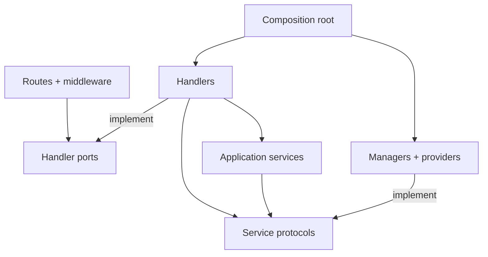

# Implementation architecture

This document describes the implemented RAG backend. It adapts the supplied *Adaptive Deterministic
RAG Platform — Architecture and Design Specification* to the current read/query-only scope. The
specification's ingestion and document lifecycle are outside this service; the only writer is the
gated local seed script, which has no HTTP route.

## Dependency rule

- `models/` and the narrow protocols in `services/contracts.py` and `handlers/contracts.py` are the
  inward-facing contracts. `models/` imports no other application package.
- Handler ports are `QueryHandler`, `TraceQueryHandler`, `ReadinessHandler`, and
  `TransportTelemetry`. Routes, middleware, and HTTP error mapping (`routes/exceptions.py`) reach
  the application only through these ports, via the `RouteContext` protocol in
  `routes/dependencies.py`. They never import `container`, managers, providers, `db`, or `scripts`.
- Routes validate transport data and invoke a handler port. They do not call databases or provider
  SDKs.
- Handlers own use-case orchestration and deterministic transitions. `SearchHandler` answers
  queries, `TenantTraceHandler` scopes trace reads, and `DependencyReadinessHandler` runs readiness
  checks.
- Services own focused query understanding, encoding, retrieval, context, generation, evaluation,
  citation, and telemetry behavior. They depend only on models, service protocols, other services,
  and utils; strategy breadth reaches them as a `RetrievalPlan` model, not a handler type.
- Managers own all normal runtime MongoDB and Qdrant operations and do not import providers.
- Providers construct or adapt external clients and translate provider responses.
- `container.py` resolves the configured implementations once at startup. Business modules contain
  no provider-selection conditionals.
- `db/initializer.py` is the deliberate exception to manager-only runtime access: it owns
  idempotent collection, index, and alias initialization during startup, not request-time business
  queries.
- `scripts/seed_dummy_data.py` is a second, gated local-development exception: it refuses to run
  outside `APP_ENV=local` and composes its own clients. No file under `src/` writes Qdrant points or
  imports `scripts`; `tests/test_seed_boundary.py` enforces both with an AST scan.
- `scripts/smoke_live_providers.py` composes the OpenAI and Cohere adapters directly to make one
  live call per operation. It reads and writes no stored data.

## Async lifecycle and concurrent requests

The FastAPI lifespan awaits `create_container` after settings validation. It validates every
configured implementation name before constructing any client, tracks each client as it is
created, and closes all of them if composition fails. The container owns and closes the
asynchronous OpenAI, Cohere HTTP, MongoDB, and Qdrant clients. Shutdown closes telemetry first,
then every client concurrently; each close is bounded by a timeout and failures are logged.

Shared objects are either SDK clients intended for concurrent use or synchronization-safe services:

- per-request RAG state is allocated inside `SearchHandler.query`;
- request ID and identity use `ContextVar` and are mirrored on `request.state`, so middleware holds
  no mutable request state and error mapping can still read them after the middleware resets;
- dense and sparse retrieval are one batched Qdrant `query_batch_points` call;
- faithfulness and completeness evaluation, and the MongoDB and Qdrant startup branches, run with
  `run_pair` (an `asyncio.TaskGroup`; a failure cancels the sibling and re-raises the original
  error);
- recovered query variants run with `run_all` under a semaphore created per call;
- the query-embedding cache is single-flight: concurrent misses for the same text share one call;
- telemetry uses a bounded queue and one background batch writer;
- shutdown stops acceptance, drains queued telemetry within a bounded time, then closes providers.

Every external stage has a timeout: follow-up detection, contextualization, query recovery,
embedding, retrieval, reranking, generation, and evaluation use the budgets in `timeouts`, and
MongoDB operations use the client-side `mongodb.operation_timeout_ms`. The handler wraps the
complete workflow in a global request deadline. Understanding and strategy attempts run under
`request_seconds - finalization_reserve_seconds`, which leaves time to fetch sources and store the
conversation turn.

When the attempt deadline expires, or a stage raises `TimeoutError` or `InfrastructureError`, the
best verified answer found so far is returned as `VERIFIED_PARTIAL` with `metadata.degraded = true`.
Without one, the error is raised unchanged. A nested provider timeout remains an operation timeout;
only an expired request or attempt deadline is reported as `REQUEST_DEADLINE_EXCEEDED`.

## Startup initialization

`DatabaseInitializer.ensure_ready` initializes MongoDB and Qdrant concurrently.

MongoDB startup:

1. pings the server;
2. creates missing application, conversation, telemetry, and trace collections;
3. ensures tenant, identity, current-version, and sequence indexes;
4. ensures trace and event TTL indexes;
5. fails startup on an incompatible existing index.

Qdrant startup works on a physical collection named `<collection_alias>__<digest>`. The digest
covers the query encoder fingerprint, the distance, the sparse IDF setting, the vector names, and
the dense dimension, so any encoder or layout change needs a new collection.

1. fails startup when the alias points to a different collection (reindex, then switch the alias),
   or when a plain collection already uses the alias name (legacy layout);
2. creates the physical collection if absent, with a cosine dense vector and a sparse vector that
   uses Qdrant's IDF modifier when the sparse encoder requires it;
3. validates the dense vector size and cosine distance, the named sparse vector, and its IDF
   modifier, and fails startup on any conflict;
4. ensures keyword payload indexes for tenant, role, document, version, and section, and a boolean
   index for `active`;
5. attaches the alias to the physical collection when it was absent, accepting only a concurrent
   create that targets the same collection.

Queries and readiness checks always address the alias.

## Query state machine

| Condition | Deterministic action |
|---|---|
| Follow-up detected in the conversation | Rewrite into a standalone canonical question |
| Initial request | Run `HAPPY_PATH` |
| Evaluators both pass | Return `COMPLETE` with sanitized verified sources and citations |
| Correctable generation failure and repair unused | Repair once, then reevaluate |
| Any other failure | Classify a retry hypothesis and run its next unused strategy |
| Budget spent and a verified partial answer exists | Return `VERIFIED_PARTIAL` with a disclosure |
| No answer with verified support | Return `INSUFFICIENT_EVIDENCE` |
| Attempt deadline or stage failure after a verified partial | Return `VERIFIED_PARTIAL`, degraded |
| Provider or deadline failure with nothing verified | Raise a typed operational error |

Query understanding is optional (`contextualization.enabled`). With conversation history, the
configured `FollowupDetector` (`model`, `heuristic`, or `always`) returns a follow-up probability and
one relevance score per earlier message. If the detector times out or its provider fails, the
request fails open and is treated as a follow-up. Below `followup_threshold` the literal question
is used. Otherwise the rewrite model sees only the messages scored at or above `message_threshold`,
plus the last `min_recent_messages`, in chronological order and within `max_context_characters`.
An empty rewrite falls back to the literal question.

`DecisionPolicy.decide_next` classifies each failed attempt; the first matching row wins:

| Hypothesis | Signal | Strategy preference |
|---|---|---|
| `CONTEXT_CONTAMINATION` | Conversation facts were used and claims are unsupported or contradicted | `CONTEXT_ISOLATION` |
| `QUERY_DRIFT` | Literal/canonical drift above threshold, evidence present but no supported claim, or several requirements with missing evidence | `QUERY_RECOVERY`, `RECALL_EXPANSION` |
| `NOT_ANSWERABLE` | Completeness judges the question not answerable | `RECALL_EXPANSION` |
| `LOW_RECALL` | No evidence, or a missing requirement absent from the evidence | `RECALL_EXPANSION`, `QUERY_RECOVERY` |
| `GENERATION_ONLY` | Evidence was present but the answer omitted it or added unsupported claims | `CONTEXT_ISOLATION` if conversation facts exist |
| `UNCLASSIFIED` | None of the above | `RECALL_EXPANSION`, `QUERY_RECOVERY`, `CONTEXT_ISOLATION` |

`CONTEXT_ISOLATION` is eligible only when conversation facts exist; it reuses the previous evidence
and omits those facts. The first unused eligible strategy runs; when none remains, the request
finalizes. Each attempt records its retry decision (hypothesis, next strategy, drift score, reason)
and failure labels derived from the failed verdicts; passing attempts carry no failure labels.

A verified partial answer needs faithful claims, at least one verified source, and at least one
answered requirement. Among partials, more answered requirements wins, then fewer unanswered ones.
It always ends with a disclosure of what could not be verified.

Each of the four strategy modules exposes a declarative `StrategyPlan` holding a `RetrievalPlan`.
The registry rejects a graph that repeats a strategy or omits one. Configuration caps both strategy
count (at most four) and generation repair count (at most one). Model outputs (judge verdicts,
failure types, extracted conversation facts, the rewritten question) select among these fixed
branches; they never name a strategy, add one, or change a budget.

## Retrieval and authorization boundary

The `QueryEncoder` encodes each query once: a dense vector from the `EmbeddingProvider` through the
single-flight cache, and a BM25 sparse vector from the `SparseEncoder`. Qdrant applies IDF on the
server. The Qdrant manager sends both searches in one batched request, appending immutable tenant,
role, and `active` filters to validated `metadata.*` filters. Qdrant returns identifiers and scores
only. Reciprocal rank fusion (or the configured weighted fusion) runs in Python and keeps each
candidate's dense and sparse score and rank.

Every fused candidate is hydrated before the result is cut to `candidate_k`, so unauthorized or
stale hits never take a slot. The MongoDB document manager then:

1. projects exactly the known chunk fields and parses them into strict Pydantic models, failing
   closed on a malformed record;
2. requires the authenticated tenant, in the query and again in Python;
3. excludes deleted documents and documents without a current version, in the query;
4. checks the chunk version against the document's authoritative current-version pointer;
5. requires an ACL intersection with authenticated roles.

The `active` payload flag is written by the indexer; version currency is enforced in MongoDB.

Only surviving chunks can be reranked, packed into a prompt, or returned as sources. Neighbour
expansion fetches through the same hydration, accepts only the same document, version, and section,
places a previous neighbour before its seed and a next neighbour after it, and packs a neighbour only
with its seed. Prompts present evidence as labels `E1`..`En`, never chunk IDs. Evaluator-cited
labels are mapped back to the packed chunks and anything unknown is dropped before it is trusted.
Inline citation markers are numbered only for verified chunks whose documents survive the final
source lookup.

## Telemetry boundary

`TelemetryService` is the single application-facing observability API. `TelemetrySink` is the
provider port; `MongoTelemetrySink` is the current adapter. Routes, middleware, and error mapping
emit through the `TransportTelemetry` handler port, and trace reads go through the `TraceReader`
protocol. This keeps a later observability adapter possible without introducing it now.

Two MongoDB collections are used:

| Collection | Content |
|---|---|
| `telemetry_events` | Low-cardinality HTTP, attempt, retry-decision, repair, completion, and error events |
| `rag_request_traces` | Full bounded workflow trace: contextualization, per-list scores and ranks, evaluations, retry decisions, model versions, provider request IDs, and usage |

Trace content is controlled by `telemetry.content_mode`: `full`, `redacted`, or `metadata_only`.
Redacted mode stores the length and an HMAC-SHA256 digest keyed by `TELEMETRY_HASH_KEY` instead of
the request or answer text. Free-text trace fields (retrieval queries, claims, requirement text,
retry reasons) become `hmac-sha256:<prefix>:len=<n>`, or `len=<n>` in metadata-only mode. Traces are
projected before they are queued, so pending traces held in memory are redacted too. Secrets are
excluded from the configuration fingerprint because Pydantic serializes `SecretStr` values as
masked data.

The queue prevents MongoDB telemetry latency from extending a completed RAG response. A pending
trace stays readable in-process until it is written, and the pending set is capped at the queue
capacity. After shutdown begins, traces are written directly under a short timeout. Shutdown waits
a bounded time for the writer to flush, then cancels it. Queue saturation, sink failures, and
server-side request failures (deadline, timeout, provider, unexpected) produce structured stderr
logs with request IDs, and those failures also emit `http.request.failed`; client errors appear in
`http.request.completed` with their status code. Validation failures are logged by type only, so
rejected input is not echoed. SDK loggers that can print payloads are held at `WARNING`. There is
no OpenTelemetry dependency or collector.

Trace reads require the debug token. A trace is visible only within the caller's tenant, to the
user who made the request or to the administrator role; any other trace returns 404.

## Provider and future-mode seams

| Capability port | Current adapter | Future change point |
|---|---|---|
| `TextModel` | OpenAI Responses API | Add adapter + resolver branch |
| `EmbeddingProvider` | OpenAI embeddings | Add adapter + resolver branch |
| `SparseEncoder` | In-repo BM25 (`Bm25SparseEncoder`) | Add encoder + `SparseEncoderName` member + resolver branch |
| `QueryEncoder` | `HybridQueryEncoder` (dense provider + sparse encoder) | A single-pass encoder such as BGE-M3 implements it directly; a new fingerprint means reindexing into a new physical collection, then switching the alias |
| `VectorSearch` | Qdrant manager | Add manager + resolver branch; the initializer and seed writer are Qdrant-specific too |
| `Reranker` | Cohere | Add adapter + resolver branch |
| `FollowupDetector` | `model` (structured classification through `TextModel`), `heuristic`, `always` | Add detector + `FollowupDetectorName` member + resolver branch |
| `TelemetrySink` | MongoDB | Add sink + resolver branch |
| `HealthCheck` | MongoDB health manager, Qdrant vector manager | Add a check to the readiness handler |
| `QueryHandler`, `TraceQueryHandler`, `ReadinessHandler` | `SearchHandler`, `TenantTraceHandler`, `DependencyReadinessHandler` | Compose another explicit implementation |
| `SearchStrategy` | Four fixed strategies | Add a strategy, registry entry, and hypothesis preference, and raise the strategy cap |

The current repository does not include Langfuse, autonomous/agentic execution, deep research,
recency bias or decay, streaming, or multiple reranker implementations. The seams above are
architectural interfaces, not dormant feature code.

## Safe extension checklist

A later implementation should:

1. add the smallest capability protocol only if an existing one is insufficient;
2. keep the concrete adapter out of handlers and routes;
3. add exactly one resolver branch in the composition root and validate its name before any client
   is constructed;
4. define timeout, error translation, resource ownership, and telemetry behavior;
5. add boundary and concurrency tests;
6. preserve tenant/role filters, finite execution budgets, verified sources, and abstention;
7. give any encoder change a new fingerprint, and reindex before switching the alias;
8. route every new free-text trace field through `TelemetryService` redaction.
